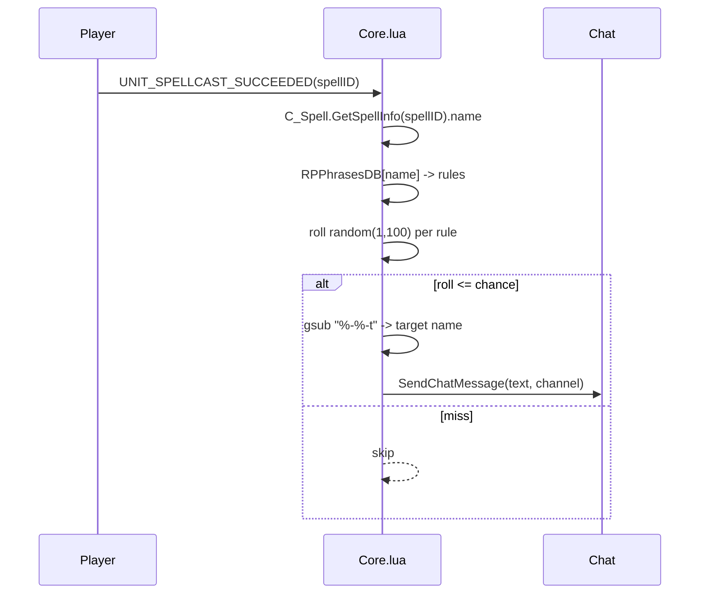

# RP Phrases

A lightweight World of Warcraft: Forever roleplay addon. Cast a spell, get a
custom chat line — with a per-rule random chance and `--t` swapped for your
target's name.

## What it does

- Link a spell to one or more chat phrases.
- Each phrase has its own trigger chance (1–100%).
- `--t` in a phrase becomes the target's name (falls back to `you` on
  no-target / AoE).
- Route each phrase to SAY, YELL, PARTY, RAID, or EMOTE.
- Everything persists via SavedVariables (`RPPhrasesDB`, keyed by spell name).

## Install

Copy the `RPPhrases` folder into the Forever client's
`Interface/AddOns/` directory (under `_forever_`, or `_retail_` for Midnight).

Requires [Ace3](https://www.wowace.com/projects/ace3) for the GUI (declared as
an optional dependency — without it, `/rp` prints a hint and rules stay in
`RPPhrasesDB`).

## Usage

`/rp` opens the config panel. Add a spell, give it phrases, set each phrase's
chance and channel. Rules are stored directly in `RPPhrasesDB`:

```lua
RPPhrasesDB = {
    ["Fireball"] = {
        { chance = 20, channel = "YELL", text = "Burn, --t!" },
        { chance = 5,  channel = "SAY",  text = "Oops, dropped my cast." },
    },
}
```

## How a cast becomes a phrase



## Status

- [x] Manifest + entry point (`RPPhrases.toc`, `Init.lua`)
- [x] Cast -> phrase engine (`Core.lua`)
- [x] Config GUI (Ace3, `GUI.lua` — full CRUD via `/rp`)
- [ ] In-game validation against the live Forever client API

## Forever API notes

Forever runs Midnight's (12.x) restricted addon API. The hazards that matter
for this addon — secret values on cast payloads, target-name lookups, and the
exact TOC interface number — are in [docs/research.md](docs/research.md). Read
it before touching `Core.lua`.

## License

MIT — see [LICENSE](LICENSE).
